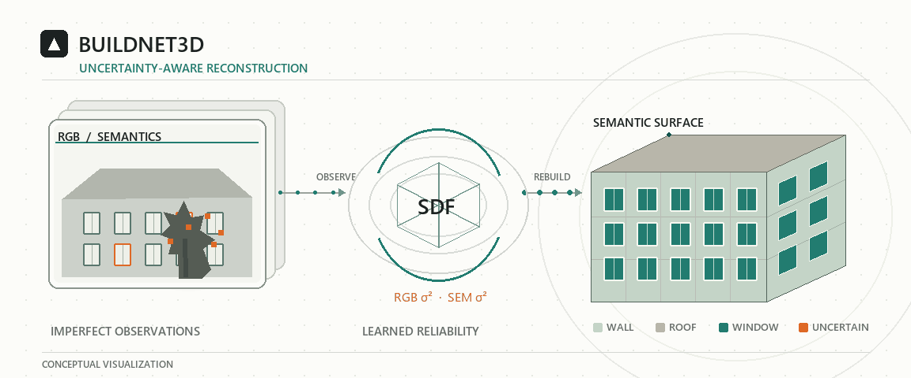
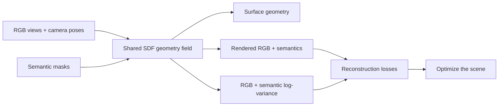
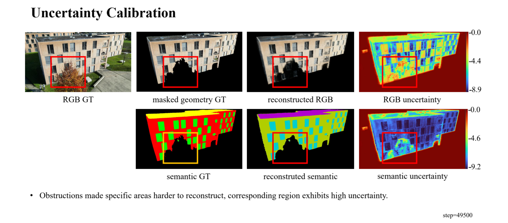
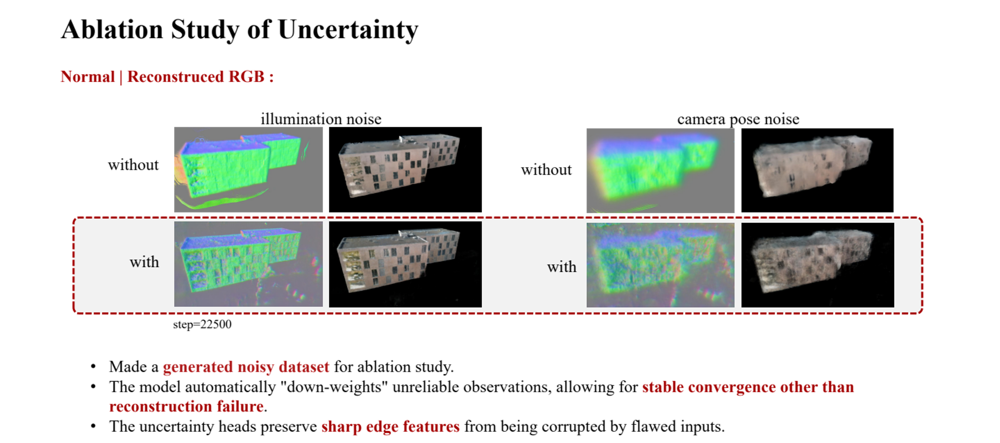

# BuildNet3D-Uncertainty: reconstruct buildings, and know where the evidence is weak

**Uncertainty-aware semantic SDF reconstruction for building envelopes.**



*Conceptual illustration: noisy observations, learned uncertainty, and a semantic building surface. The experiment figures below show actual results.*

> A window edge is blurred. A tree hides part of a facade. A camera pose drifts. A semantic mask gets a roof pixel wrong. A reconstruction system should not treat all of those observations as equally trustworthy.

This research fork extends [BuildNet3D](https://github.com/EPFL-IMOS/buildnet3d) with an SDF model that predicts **RGB and semantic uncertainty** alongside geometry, color, and semantic labels. The goal is to make building reconstruction more robust when images and labels are imperfect.

[Original paper](https://doi.org/10.1016/j.buildenv.2025.112731) · [BuildNet3D dataset](https://zenodo.org/records/15075790) · [Upstream code](https://github.com/EPFL-IMOS/buildnet3d)

## The problem

Semantic 3D reconstruction is useful when a building model needs more than a plausible shape: surfaces must also be identified as walls, roofs, windows, and other components. Those labels support downstream tasks such as estimating a window-to-wall ratio.

In a controlled dataset, RGB frames and semantic masks can look like ground truth. In a real capture, they are observations with different failure modes: changing light, camera motion, low resolution, occlusion, boundary aliasing, and incorrect labels. When every pixel receives the same penalty, a few bad observations can distort the reconstructed surface or its semantics.

**The idea:** let the scene representation estimate where its own observations are unreliable, then use that estimate during optimization.

## How it works

The model builds on a NeuS-style signed distance field (SDF). A shared geometry representation feeds the usual color and semantic heads, plus two uncertainty heads that predict log-variance for RGB and semantic outputs.



- **RGB uncertainty** adds a heteroscedastic term alongside the regular RGB loss: errors receive less weight in that term where the model predicts high variance, while a log-variance penalty discourages it from declaring everything uncertain.
- **Semantic uncertainty** perturbs semantic logits and averages the resulting probabilities before computing the label loss. This lets ambiguous labels contribute differently from confident ones.
- **Delayed activation** gives the geometry and appearance heads time to learn before the uncertainty losses become active.
- **Missing semantics** are handled by the uncertainty model: if no semantic directory is loaded, semantic reconstruction and its loss are disabled. The RGB path remains available.

The implemented models are [`semantic-sdf`](buildnet3d/models/semantic_sdf.py) and [`uncertainty-semantic-sdf`](buildnet3d/models/uncertainty_semantic_sdf.py). Their configurations are in [`method_configs.py`](buildnet3d/models/method_configs.py).

## What the experiments show

The January 2026 project presentation reports **qualitative** evidence. Predicted uncertainty rises around difficult windows, edges, reflective roof regions, and occlusions. In a synthetic noise ablation with illumination and camera-pose corruption, the uncertainty-enabled reconstruction retains more recognizable building structure than the comparison without uncertainty. These figures are illustrative; this README does not claim a numerical benchmark or universal robustness guarantee.

**Uncertainty follows an occlusion.** The highlighted area is obstructed in the input and receives elevated RGB and semantic uncertainty in the reconstruction.



**Ablation under noisy inputs.** The presentation compares reconstructions with and without uncertainty under illumination and camera-pose noise.



The same presentation benchmarks Grounded-SAM 2 variants for building-part segmentation. **Grounded-SAM 2 is not wired into the training pipeline in this repository.** Automatic online semantic prediction and uncertainty-guided view selection remain future work.

## Run it

### 1. Install

Use a CUDA-capable machine. The upstream project reports testing on an A100 with Python 3.10, PyTorch 2.0.1, and CUDA 11.8; this fork has not been validated here across other environments. Install a compatible PyTorch/CUDA stack before the editable packages.

```bash
git clone --recurse-submodules https://github.com/Shuyi215/buildnet3d.git
cd buildnet3d

python -m pip install -e ./nerfstudio
python -m pip install -e .

# Set the CUDA architecture for your GPU before installing tiny-cuda-nn.
TCNN_CUDA_ARCHITECTURES=<YOUR_ARCH> \
  python -m pip install 'git+https://github.com/NVlabs/tiny-cuda-nn/#subdirectory=bindings/torch'
```

For the optional Gaussian-splatting baseline, the upstream setup also uses `gsplat==1.0.0` and a different PyTorch/torchvision pairing. See the [upstream README](https://github.com/EPFL-IMOS/buildnet3d#installation) before using `splatfacto`.

### 2. Prepare a scene

Download the [BuildNet3D dataset](https://zenodo.org/records/15075790) or prepare a scene for the [`BuildNet` data parser](buildnet3d/data/buildnet_dataparser.py). The semantic SDF configurations expect `meta_data.json`, an `images/` directory, and foreground `masks/`. When semantic supervision is available, also provide `semantic/` and `segmentation_data.json`. Metadata frames contain image paths, camera intrinsics and poses, and paths for the enabled masks and labels.

The dataset is not bundled with this repository. Train/eval splitting is defined in the data parser; the supplied semantic SDF configurations use an interval split with every eighth frame for evaluation.

### 3. Train and evaluate

Run from the repository root:

```bash
# Uncertainty-aware model (default model type)
python buildnet3d/scripts/reconstruct.py \
  --model-type uncertainty-semantic-sdf \
  --data /path/to/scene \
  --experiment-name building-uncertainty

# Semantic SDF baseline
python buildnet3d/scripts/reconstruct.py \
  --model-type semantic-sdf \
  --data /path/to/scene \
  --experiment-name building-baseline

# Evaluate a saved run; use its generated config.yml
python buildnet3d/scripts/evaluate.py \
  --load-config /path/to/outputs/.../config.yml \
  --output-path eval.json
```

The training entry point also supports `neus`, `nerfacto`, and `splatfacto` baselines. For controlled comparisons, edit the scene path in [`experiments/configs/exp1_pipeline.yaml`](experiments/configs/exp1_pipeline.yaml), then preview its jobs before launching them:

```bash
python buildnet3d/scripts/run_sweep.py \
  --sweep-yaml experiments/configs/exp1_pipeline.yaml \
  --dry-run
```

## Repository map

- [`buildnet3d/models/`](buildnet3d/models/) — semantic SDF, uncertainty heads, losses, and method configurations.
- [`buildnet3d/data/`](buildnet3d/data/) — scene parser, semantic labels, masks, and train/eval splitting.
- [`buildnet3d/scripts/`](buildnet3d/scripts/) — training, evaluation, rendering, and experiment sweeps.
- [`experiments/configs/`](experiments/configs/) — baseline and loss-parameter experiment definitions.
- [`bproc_generator/`](bproc_generator/) — BlenderProc pipeline for synthetic RGB, depth, normal, semantic, and instance data.

## Origin and citation

This repository is a **research extension** of the [EPFL-IMOS BuildNet3D project](https://github.com/EPFL-IMOS/buildnet3d), developed for Shuyi Chen's bachelor semester project, *Online Semantic Neural Scene Reconstruction with Uncertainty Quantification* (January 2026). The upstream paper introduced semantic scene reconstruction for building-envelope analysis; the uncertainty model and experiments in this fork are separate project work.

If you use the original BuildNet3D method or dataset, cite the upstream paper:

```bibtex
@article{XU2025112731,
  title   = {Exploiting semantic scene reconstruction for estimating building envelope characteristics},
  author  = {Chenghao Xu and Malcolm Mielle and Antoine Laborde and Ali Waseem and Florent Forest and Olga Fink},
  journal = {Building and Environment},
  volume  = {275},
  pages   = {112731},
  year    = {2025},
  doi     = {10.1016/j.buildenv.2025.112731}
}
```
